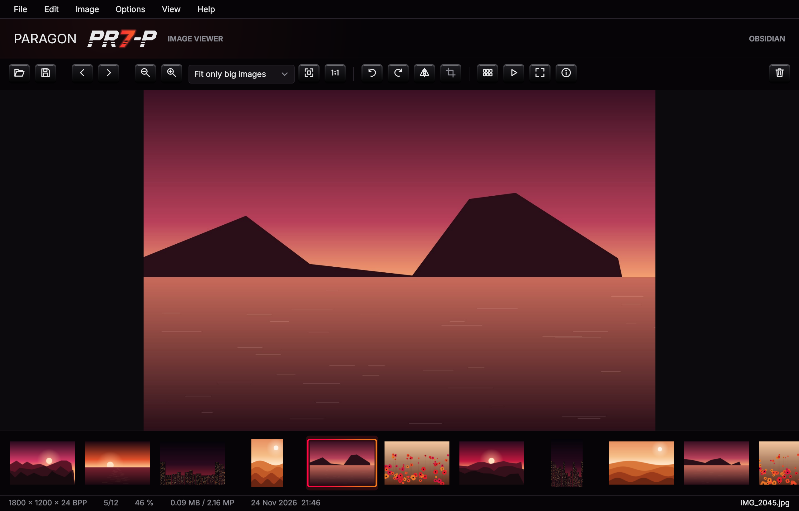

# Paragon PR7-P

An image viewer for Windows 10/11 that works the way **IrfanView** and **ImageGlass** work, in the Paragon family
look (PR7-Z, PR7-W, PR7-L, PR7-F, PR7-E, PR7-R). Python, PySide6 and Pillow.



## What it does

- **Formats**: JPEG, PNG, GIF (animated), WebP, BMP, TIFF, ICO, SVG, TGA (Qt) and AVIF, JPEG 2000, PCX, Photoshop
  (Pillow). The camera's orientation tag is applied. HEIC isn't read (no codec in Qt or Pillow without extras).
- **Moving through a folder**: Right / Left / Space / Backspace / the mouse wheel, Home / End, sorted by name the
  natural way, round from the last to the first; ImageGlass's thumbnail strip under the picture.
- **Zoom**: fit only big images (default), fit to window, original size, IrfanView's steps; Ctrl+wheel zooms at
  the pointer; right drag moves the picture; left drag draws a selection.
- **Image menu**: rotate (L / R, fine rotation), flip (V / H), crop selection, resize, canvas size, auto-adjust,
  sharpen, colour corrections, greyscale, negative; Undo / Redo.
- **Saving**: Save (Ctrl+S) and Save as (S) in JPEG (quality in Options, camera details kept), PNG, WebP, BMP, TIFF,
  GIF, AVIF. A changed picture asks before you leave it.
- **Files**: Copy to (F8), Move to (F7), Rename (F2), Delete to the Recycle Bin (Del), Show in folder, Set as
  wallpaper, Print.
- **Image information (I)** with the camera details; **Thumbnails (T)**; **Slideshow (W)**; **full screen** (Enter).
- One window: opening another picture from Explorer shows it there. Check for updates; OBSIDIAN and AURORA.

## Install

Download `PR7-P-Setup-x.y.z.exe` from Releases. It installs for you only (no admin rights) and registers PR7-P as an
image viewer. To make it the default: Options > Properties > "Make PR7-P the default image viewer".

## Develop

```
pip install -r requirements.txt -r requirements-dev.txt
python -m pr7p some-picture.jpg
python -m pytest
QT_SCALE_FACTOR=2 python tools/screenshots.py OUT
```
